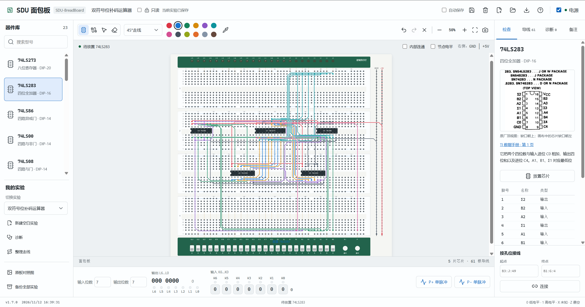
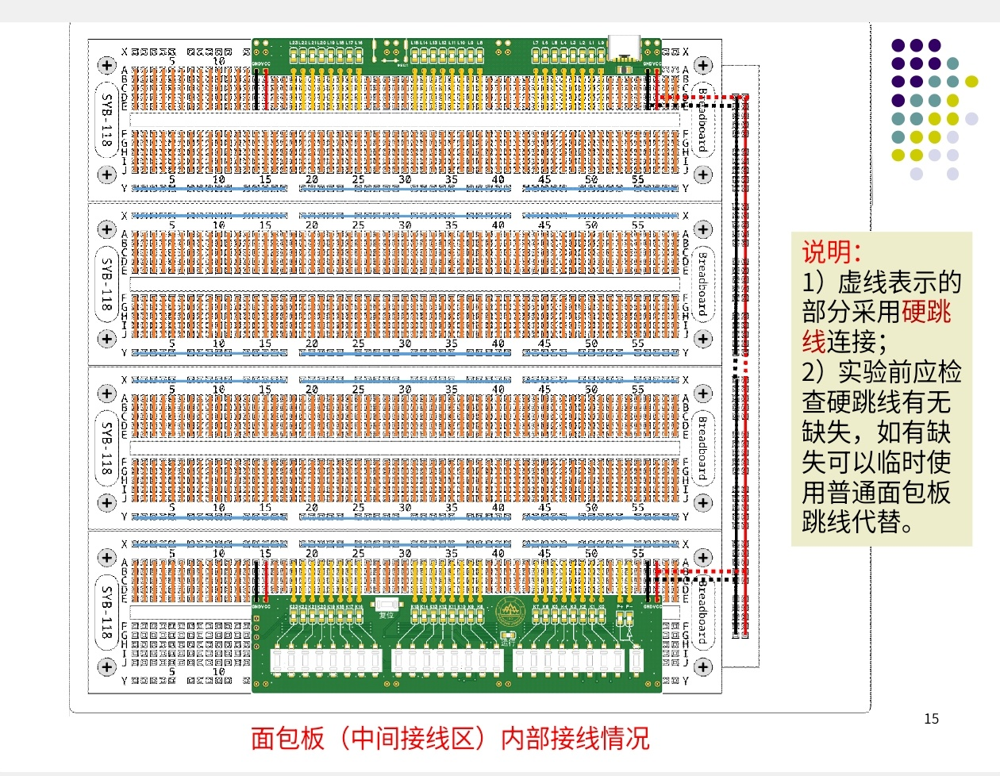

# SDU 面包板模拟器

SDU-BreadBoard 是基于山东大学计算机组成原理实验的面包板设计的模拟器。由此，你可以直接在**本地**完成数字电路接线测试

作者：Octorange/Windy-Field

你可以从[发布页下载离线包](https://github.com/Windy-Field/SDU-BreadBoard/releases/latest)，也可以使用仓库的 **Code → Download ZIP**。将压缩包完整解压，再双击 `index.html`，即可使用

需要重新打包时，你可以双击 Windows 下的 `package.cmd`。程序会在 `releases` 文件夹生成离线 ZIP，里面只包含运行文件和使用资料。[打包说明](docs/packaging.md)介绍了更新和验证方法

## 最新页面

## 近期版本

### v1.7.0 · 2026-11-12

重新设计了布线方案，现在使用的是 libavoid 正交避障引擎，由算法统一安排线路和间距，并能绕开芯片

逐根添加导线时也会自动规划路径了。你可以直接连接两个插孔，也可以先指定中间转折点，程序会经过这些位置继续接线

“整理走线”和逐根接线使用同一个引擎，画布显示、点击选择和文件中保存的路线保持一致

### v1.6.3 · 2026-11-12

工具栏新增“45°走线”，同时默认使用 45° 走线。现在你可以用横线、竖线和斜线安排路径。不同走线模式下点击“整理走线”的整理方案不同

优化“整理走线”方案，现在优先减少拐角，再在相同拐角数下减少重叠、调整间距，起点和终点保持不变。45° 模式直接寻找斜线路径，不再额外添加装饰性转弯

### v1.4.2 · 2026-11-11

复查了全部的 23 种芯片并修正了计数器非法状态的恢复和部分未知值传播等问题，同时也增加了供电、全部字形、同钟采样与级联测试，可详见[芯片核查报告](docs/chip-audit.md)

更新了更直观的界面显示，部分地方的细线常显直连关系一定要仔细看（例如第四块面包板）！

节点电平显示更新，现在使用 0、1、X、Z 的字符显示

【注意：第四块面包板的输入与脉冲对应列之间通过细线连接上下五孔组，以模拟原板中输入模块覆盖半块板的结构】

修复了 `package.cmd`

你可以查看[完整版本记录](docs/changelog.md)和[使用说明](docs/user-guide.md)

## 参考面包板

部分芯片资料与接线核对方式请见[资料说明](docs/chip-references.md)
