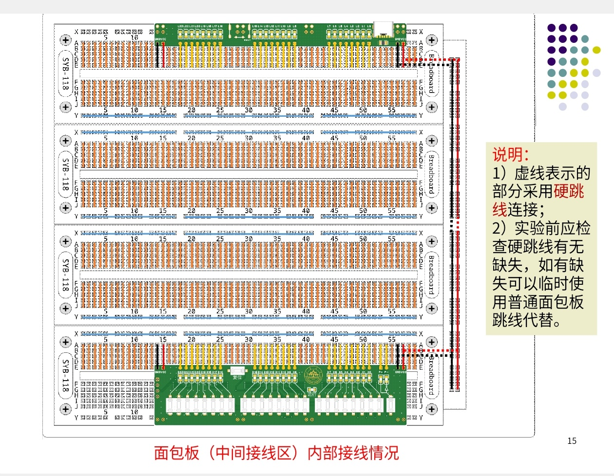

# SDU 面包板模拟器

SDU-BreadBoard 是基于山东大学计算机组成原理实验的面包板设计的模拟器。由此，你可以直接在**本地**完成数字电路接线测试

**作者：Octorange/Windy-Field**

你可以从[发布页下载离线包](https://github.com/Windy-Field/SDU-BreadBoard/releases/latest)，也可以使用仓库的 **Code → Download ZIP**。将压缩包完整解压，再双击 `index.html`，即可使用

现在也已经提供了 Windows 桌面版提供 64 位安装包和免安装程序。桌面版启动后及运行期间会自动检查 GitHub 正式版，安装版后台下载并提示重启安装，免安装版则会提示下载新版

## 最新页面

## 近期版本

### v1.10.0 · 2026-11-18

cga！新增波形图的显示与导出

现在存档和逻辑电路图可以自定义导出方式和导出位置了

增加免责申明公告栏

### v1.9.2 · 2026-11-18

新增第二份实验“RAM 字扩展”存档，具体操作方法请见右侧说明

优化桌面版与便携版启动速度，提升约 50%

整理了工作区

修复备份保存、撤销、越界拖线和脉冲按钮问题，改进界面提示、动效及画布性能

现在切换有改动的实验前会询问是否保存

### v1.8.3 · 2026-11-15

cga！新增“显示逻辑电路图”功能，现在在绝大多数情况下都可以自动根据当前面包板接线方法生成对应的逻辑电路图了

支持桌面版

现在面包板和逻辑电路图均支持左键长按拖拽了、右键框选了，逻辑图也支持 Ctrl + 左键多选了

具体内容请见[逻辑图说明](docs/logic-diagram.md)

### v1.7.2 · 2026-11-13

芯片资料现在支持多项置顶了，各份资料可以独立滚动，上下空间也可以拖动分配

重新设计了布线方案，现在使用的是 libavoid 正交避障引擎，它由算法统一安排线路和间距，并能绕开芯片

逐根添加导线时也会自动规划路径了

修复了安装包中输出灯显示为 “X” 的 bug

### v1.6.3 · 2026-11-12

工具栏新增“45°走线”，同时默认使用 45° 走线。现在你可以用横线、竖线和斜线安排路径。不同走线模式下点击“整理走线”的整理方案不同

优化“整理走线”方案，现在优先减少拐角，再在相同拐角数下减少重叠、调整间距，起点和终点保持不变。45° 模式直接寻找斜线路径，不再额外添加装饰性转弯

你可以查看[完整版本记录](docs/changelog.md)和[使用说明](docs/user-guide.md)

## 参考面包板

部分芯片资料与接线核对方式请见[资料说明](docs/chip-references.md)
