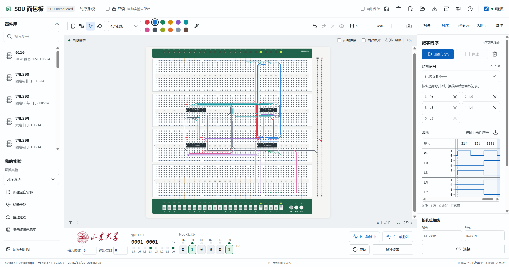
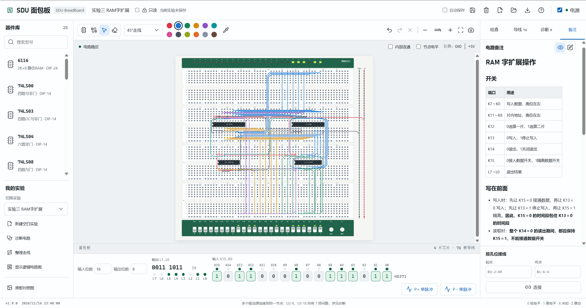
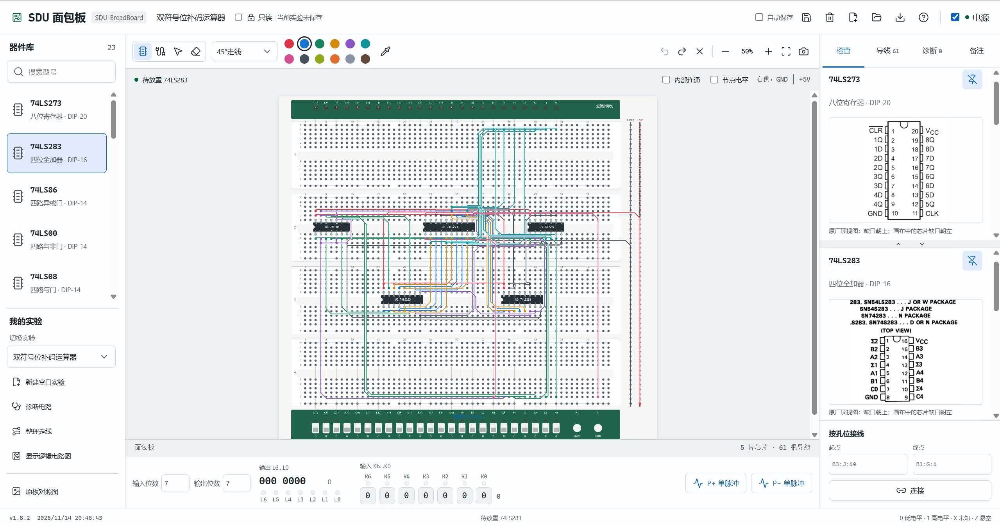
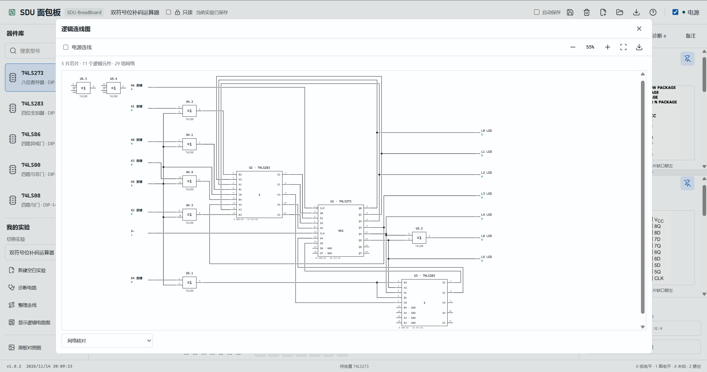

# SDU 面包板模拟器

SDU-BreadBoard 模拟了山东大学计算机组成原理实验用的面包板。你可以在本地接线、切换输入，再观察数字电路的输出。

**作者：Octorange/Windy-Field**

你可以从[发布页下载离线包](https://github.com/Windy-Field/SDU-BreadBoard/releases/latest)，也可以使用仓库的 **Code → Download ZIP**。将压缩包完整解压，再双击 `index.html`，即可使用

Windows 桌面版提供 64 位安装包和免安装程序。两个版本都会在启动后和运行期间检查 GitHub 正式版。发现更新后，安装版会在后台下载，再提示重启安装。免安装版会提示你下载新版本。

## 最新页面

## 近期版本

### v1.12.2 · 2026-11-22

cga！新增[实验四「时序系统」存档](examples/timing-system.json)

面包板新增复位按钮与脉冲设置（可支持连续脉冲和三态模式了，实际的面包板也支持这两种模式）

安装版、便携版和桌面端打开的共享网页可以共用同一份本机存档了

迁入旧存档和生成个人快照包的步骤请见[下载与打包](docs/packaging.md)

### v1.11.0 · 2026-11-21

现在导线可以快捷隐藏为原色虚线了，且支持查找、恢复与撤销

现在四块面包板的中央卡槽上会标出 1、3、5……59 的奇数列号了

你可以查看[完整版本记录](docs/changelog.md)和[使用说明](docs/user-guide.md)

## 参考面包板

部分芯片资料与接线核对方式请见[资料说明](docs/chip-references.md)
